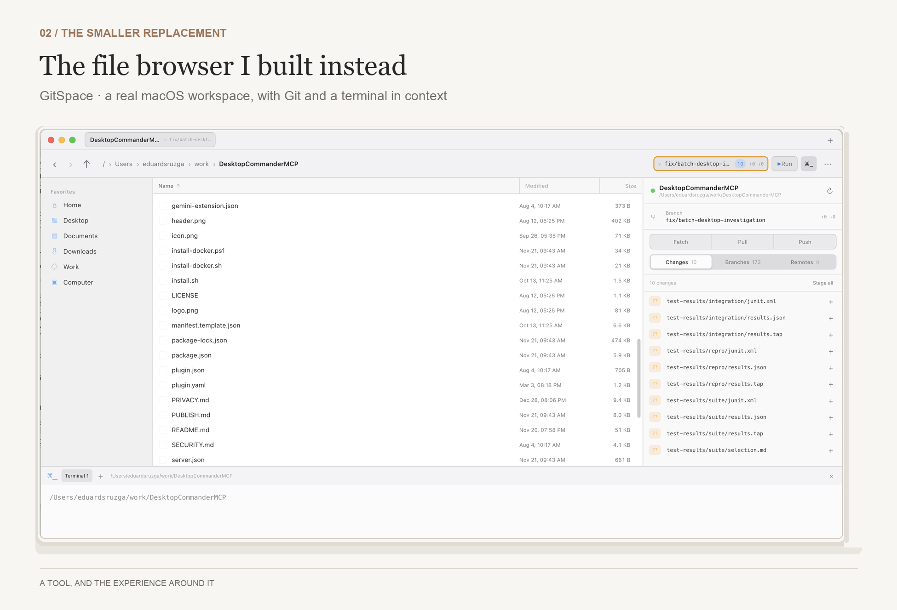

# Gitspace

A filesystem-first desktop browser with a terminal in the current folder and contextual Git controls.

## Screenshot



*Gitspace is a filesystem-first workspace. Git controls appear only for repositories, and the terminal follows the current folder.*

## Product model

Gitspace behaves more like Finder than an IDE:

- Navigate folders anywhere on the filesystem.
- Double-click folders to enter them and files to open them with macOS.
- Use Back, Forward, Up, breadcrumbs, Favorites, or **Open Folder…** from the `•••` menu.
- Sort the file list by **Name**, **Modified**, or **Size** by clicking the column headers.
- Git and Terminal are collapsed by default so the file browser owns the window.
- When the current folder is inside a Git repository, a compact branch pill appears in the toolbar.
- Click the branch pill to open the Git inspector.
- Outside Git repositories, Git controls disappear.

## Git features

The contextual Git inspector currently supports:

- Current branch and ahead/behind state
- Local branches
- Remote branches
- Switch local branches
- Create a new branch from any local or remote branch
- Fetch all remotes
- Pull with fast-forward-only safety
- Push, including first-time upstream creation
- Remotes and their fetch/push URLs
- Changed files
- Stage / unstage individual paths
- Stage / unstage all
- Commit staged changes
- Last commit and configured upstream

Git operations surface the underlying Git error instead of hiding conflicts or unsafe branch switches.

## Terminal

The terminal uses a real PTY via `node-pty` and renders with xterm.js.

- Press `⌘J` or use the toolbar button to show/hide Terminal.
- Terminal follows macOS light/dark appearance.
- Changing folders in the browser restarts the shell in the selected folder so the filesystem view and terminal stay aligned.
- If a branch switch removes the folder you are currently viewing, Gitspace falls back to the repository root and restarts Terminal there.

## Quick Run

The toolbar shows **Run** when the current folder or current selection has something useful to run.

For a folder containing `package.json`:

- scripts are discovered automatically
- npm / pnpm / yarn / bun is inferred from lockfiles
- choosing a script runs it in Terminal

For selected files and folders:

- common script files such as `.sh`, `.zsh`, `.py`, `.js`, `.ts`, `.rb`, `.php`, `.pl`, and `.lua` can be run directly
- executable files can be run directly
- **Insert Path** writes the selected path into Terminal without executing it
- **Terminal Here** navigates into a selected folder and opens Terminal there

The same actions are available from the file/folder right-click menu.

## Run Gitspace

Install once:

```bash
npm install
```

Normal use:

```bash
npm run app
```

Development with Vite hot reload:

```bash
npm run dev
```

To start in a specific folder during development/testing:

```bash
GITSPACE_PATH=/path/to/folder npm run app
```

## Keyboard

- `⌘O` — Open Folder
- `⌘[` — Back
- `⌘]` — Forward
- `⌘J` — Toggle Terminal

## Stack

- Electron
- React + Vite
- xterm.js
- node-pty
- system Git executable

## Current scope

This is a macOS-first MVP. It intentionally does not yet include file operations such as rename/copy/delete, Git history/diff views, stash/rebase/merge UI, multiple terminal tabs, or persistent favorites.

## Open source

MIT licensed, macOS-first experimental Electron desktop app. Clone, run npm install, then npm run app. No compiled release is provided yet.
